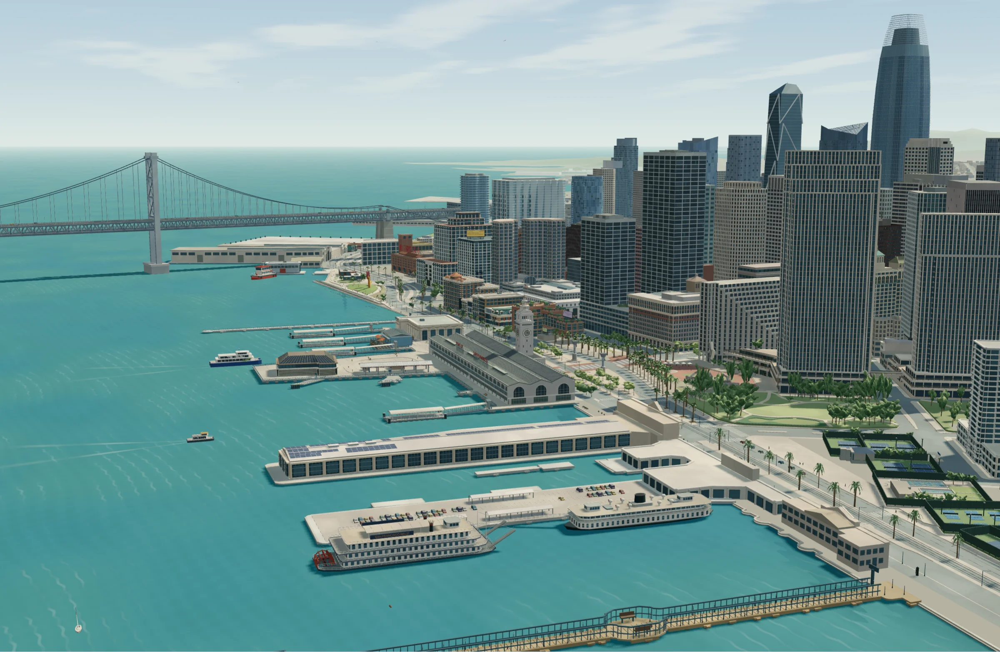

# San Francisco Waterfront

I wanted a fun, little, interactive cityscape of the Embarcadero as the header image for my portfolio. Here is the result, built with Typescript and Javascript primary.



Detailed representations of the Ferry Building, Bay Bridge, surrounding architecture, people, parks, streetcars, ferries and a departing fireboat with a rotating water salute. Time of day, building lights and the clock follow San Francisco time. Open **Custom** to choose a local time, weather, or both. Your choices are saved in this browser. **Reset to live** returns both controls to the waterfront clock and weather.

## Run locally

Use Node.js 22.18 or newer.

```sh
npm ci
npm run dev
```

Build static files with `npm run build`; review that build with `npm run preview`. `dist/` can be served by a static host. No backend, database, API key or ChatGPT account is needed.

## Explore

- In **Custom → View**, choose **Bay Bridge drive** for the westbound upper deck into San Francisco, or **F-line streetcar** to board by the San Francisco Railway Museum, turn onto the Embarcadero, and ride north past the Ferry Building to Broadway. Each ride has its own pause button. **Return** or Escape brings you back to your waterfront view.
- Drag to orbit and tilt. Double-click or pinch to change the focal length. On touchscreens, move two fingers vertically together to tilt. The lens stays aimed at the Ferry Building.
- The bottom-right controls zoom, return to the opening view, and pause or resume motion.
- With the city focused, use the arrow keys to orbit and tilt, `+` and `−` to zoom, Escape to reset, and Enter to hear from a passerby.
- On touch screens, drag horizontally to orbit or pinch to change the lens. The page scrolls with one finger. Motion pauses in a hidden tab and honors the system reduced-motion preference. An explicit pause or resume is remembered.

The fireboat leaves Station 35, performs its five-stream display, and returns on a two-minute animation cycle. Pausing the scene also pauses the boat and water.

## Development and updates

The city is maintained with Tom's portfolio project. A local post-commit hook exports the committed city dependency graph, its map, poster, styles and tests into this repository. It runs type checking, the geometry/animation tests and a production build before pushing to `main`. Portfolio copy, résumé content, contact information and hosting configuration are excluded.

`CITY-SOURCE.json` records the source revision and file hashes. The mirror never copies uncommitted portfolio edits. A failed check or push leaves a visible error and can be retried with `npm run city:sync` from the source project. Synchronization runs when the source project is committed on Tom's Mac; it is not a background cloud watcher.

The repository can be cloned and developed independently. Changes to the managed mirror should be made in the source project before synchronization; the sync process stops if someone has independently changed a managed file here.

## Regenerate the waterfront posters

Install Node.js 22.18 or newer, run `npm ci`, and install a recent Chrome or Chromium with antialiased WebGL 2 available in headless mode. Start the standalone city in one terminal.

```sh
npm run dev -- --host localhost --port 5173 --strictPort
```

In a second terminal, run the capture from the same checkout.

```sh
npm run poster
```

The capture defaults to `http://localhost:5173/`. Pass a different local preview URL with `npm run poster -- --url http://localhost:4173/`. Set `CHROME_PATH` to the executable if it lives outside a standard installation directory or your PATH.

The script opens a temporary Chrome profile and pauses the live WebGL scene under fixed afternoon and night lighting. It captures only the canvas at 1440×940 and 390×844 CSS pixels, with native high-density drawing buffers. It writes `city-poster.webp`, `city-poster-portrait.webp`, `city-night.webp`, and `city-night-portrait.webp` in `public/` after validating all four captures.

## Checks

```sh
npm run check
npm run build
```

With the preview running, `npm run poster -- --check-interactions --check-fog` exercises the arrival fog, keyboard and touch conversations, camera controls, pause persistence and reduced motion in Chrome. Add `--evidence-dir /path/to/folder` to retain the screenshots.

Tests cover finite batched geometry, daylight and DST, opening composition, full-horizon stars, smooth camera settling, park and tree placement, roof visibility, street routes, ferry and fireboat clearance, water contact, shared character animation and atmospheric haze. Physical-device thermal behavior and frame-rate benchmarks have not been established.

## Attribution and rights

Map data © [OpenStreetMap contributors](https://www.openstreetmap.org/copyright), available under [ODbL 1.0](https://opendatacommons.org/licenses/odbl/1-0/). The mapped features are included in the datasets under `public/data`. Regional elevations come from the [Mapzen Terrarium terrain archive](https://registry.opendata.aws/terrain-tiles/). Keep the page and data attribution when reusing them.

The [reference audit](references/WATERFRONT-REFERENCE-AUDIT.md) records the photographs, architectural sources and map features used for Embarcadero Center, the parks, historic piers and waterfront façades, along with unverified areas. `scripts/import-waterfront-landscape.py` reproduces the landscape data import.

The poster is rendered from this project's own geometry. Buildings and vessels are stylized approximations, not surveyed reconstructions. The fireboat is inspired by the SFFD's St. Francis. No AI-generated bitmap artwork is used.

The bundled Helvetiker font includes its MAGENTA/MgOpen license in the JSON metadata and in `THIRD-PARTY-NOTICES.md`. Other dependencies retain their respective licenses.

Original project code and artwork © 2026 Tom Bunting. This public repository does not add a separate open-source license for that original work.
